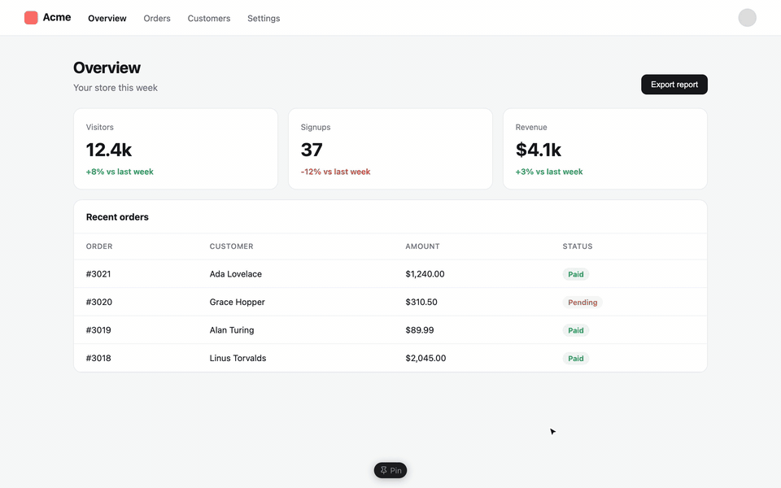

# React Pin

A browser extension for pointing at UI and handing it to a coding agent (Claude Code, Codex, Cursor,
…). Hover an element in your React dev server and copy its component and source line, or click a
few elements, write a note on each, and copy them all as one prompt.



- **One element:** turn Pin on, hover, press **⌘C** (Ctrl+C on Windows/Linux):
  ```md
  ### StatCard "37"
  Element: `app/StatCard.tsx:7` · `div.card.stat:nth-of-type(2) > strong.stat-value`
  ```
- **Feedback on several:** click elements and type a note on each (numbered pins mark them), then
  **Copy feedback**:
  ```md
  ## UI feedback
  Page: http://localhost:3000/
  Viewport: 1280×800

  ### 1. StatCard "37"
  Element: `app/StatCard.tsx:7` · `div.card.stat:nth-of-type(2) > strong.stat-value`
  Feedback: Make the drop less alarming: amber, not red

  ### 2. Page "Export report"
  Element: `app/page.tsx:18` · `button.btn`
  Feedback: Secondary style, not the main action
  ```

## Install

- **Chrome Web Store:** _link coming once it's published_
- **From source:** clone this repo, open `chrome://extensions`, turn on Developer mode, **Load
  unpacked**, pick the folder. Works in Chrome, Edge, Brave, Arc and other Chromium browsers
  (111+). No build step.

## Use

| | macOS | Windows / Linux |
| --- | --- | --- |
| Turn Pin on or off | **⌃P** | **Alt+Shift+P** |
| Copy the hovered element (while on) | **⌘C** | **Ctrl+C** |
| Copy all feedback (while on) | **⌃C** | **Alt+Shift+C** |
| Turn Pin off | **Esc** | **Esc** |

The on/off shortcut is the browser's extension shortcut, so you can change it at
`chrome://extensions/shortcuts` (there's also an optional "Copy all feedback notes" shortcut to
bind). The copy keys only act while Pin is on, so normal copy and print work as usual otherwise;
⌘C / Ctrl+C still copies selected text.

- **The island** (bottom center) has the Pin toggle, **Copy feedback** and **Clear**. Drag it to
  any edge; drag it out of the window to hide it on that site.
- **The toolbar button** shows or hides it on the current site. Right-click it for **Always load on
  this site**.
- **Options** (right-click the toolbar button → Options): shortcuts, whether it shows on localhost
  by itself, sites it always loads on, and whether copied text includes the selector and page URL.

## Where it runs

On `localhost`, `127.0.0.1` and `*.localhost` it loads by itself. Anywhere else (a LAN address, a
staging URL, any site) it loads only when you click the toolbar button or press the toggle
shortcut, through `activeTab`: no access to other sites until you ask. **Always load on this site**
asks for permission for just that site.

## How it finds the source

React keeps each element's component on its DOM node; Pin runs in the page's own world to read it.

- **React 19** records the stack where each element was created (`_debugStack`). Its first app frame
  is in served, bundled code, so Pin maps it back through the script's source map: inline (Vite),
  a `.map` file (webpack, Create React App), index maps (Turbopack), or the map inside a webpack
  `eval` module. Next.js server components are mapped by the Next dev server itself, the same way
  its error overlay does.
- **React 18 and earlier** have `_debugSource` (file and line, from Babel's JSX transform).
- **Without React** (or in a production build) you still get a selector that matches only that
  element, plus its text.

Tested with Next.js 16 (Turbopack and webpack, client and server components), Vite with React 18
and 19, and webpack 5 with `cheap-module-source-map` (what Create React App uses).

## Privacy

Nothing leaves your browser: no servers, analytics or tracking. See [PRIVACY.md](PRIVACY.md).

## Development

```
manifest.json   MV3: content scripts on localhost, toolbar button, shortcuts, options
background.js   toolbar button, shortcuts, "Always load on this site" (optional host permissions)
bridge.js       the extension-world side of pin.js: passes settings and shortcut names
pin.js          everything else, in the page's world: picking, notes, the island, source lookup
options.html    options page (options.js)
store/          Chrome Web Store listing text, screenshots, icon and promo tiles
```

Edit, then ↻ on the extension's card in `chrome://extensions`. `scripts/build.sh` makes the store
zip in `dist/`.

## License

[MIT](LICENSE). Not affiliated with Meta or the React team; "React" names the library it works
with.
